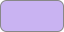

# Design System: juais.se

Reference for the Head of Growth. Lists every color, font, logo, radius and pattern the website uses, and where each one is defined.

All paths are relative to the repo root. Snapshot of the code on 2026-11-18. The palette is still Growth's preliminary Brand Version 0/0.1.

---

## 1. How to request a change

Use one line per change and name the token or file:

```
--color-accent → #D4C2F7
--font-heading → "Fraunces"
--radius-md → 8px
logo-dark.svg → replace with new file from Growth
```

- **Colors and fonts** live in `src/styles/theme.css`. Changing a token there updates the whole site, including the hero dot animation, the animated logo and the QR codes.
- **After a color change**, run `npm run swatches` to refresh the color swatch images in `docs/swatches/` and update the Hex column in 2.1.
- **Name** (`JU AIS` / `Jönköping University AI Student Association`) lives in `src/config.ts` (`name`, `shortName`).
- **Logos and favicons** are separate files in `public/`. They contain fixed hex colors, so a token change does **not** recolor them. They have to be re-exported (see section 4).
- **Shapes and mono sizes** are tokens in `src/styles/theme.css` too: radii (`--radius-*`, 5.1) and mono text sizes (`--text-*`, 3.2). Other sizes and spacing are set per component (sections 3, 7). To change one of those, name the element, for example "event card padding".

---

## 2. Colors

### 2.1 Tokens (`src/styles/theme.css`)

`npm run swatches` regenerates the swatch images from the hex tokens. Derived tokens have no swatch.

| Swatch | Token | Hex | Growth name | Where it's used |
|---|---|---|---|---|
|  | `--color-primary` | `#4A2390` | Spark Violet | "Next event" bar under the hero, QR code eyes (corner squares), the tile behind the logo in the middle of the QR code, QR card 3D edge |
|  | `--color-secondary` | `#5B2A86` | Orchid | "Next event" bar when hovered |
|  | `--color-deep` | `#3F2475` | Deep Iris | Bottom layer of the QR card 3D edge only |
|  | `--color-accent` | `#C9B3F2` | Lavender Glow | Primary button background (`.btn--primary`: Join, Sign up, Get in touch, Download PNG), all `.label` text (eyebrows, dates, "Next event"), "Details & sign-up →" on event cards, event cover month and dot pattern, hero dot animation, animated logo orbits and glow, What we do meter dots, keyboard focus ring, QR card 3D edge |
|  | `--color-bg-dark` | `#1F1630` | *(not in Growth palette)* | Page background behind everything, navbar, footer, every `.section--dark` (hero, page headers, Join CTA), modal backdrop and close button (tinted) |
|  | `--color-bg` | `#2E2246` | *(not in Growth palette)* | Main content background (`<main>`), event cover placeholder |
|  | `--color-bg-soft` | `#42325F` | *(not in Growth palette)* | Cards: event cards, event modal, What we do activity cards, secondary buttons (`.btn--secondary`: links page, QR page) |
|  | `--color-text` | `#FFFFFF` | Paper White | All text on dark: body, headings, navbar, footer, dark sections, animated logo dots and spark, hamburger icon. Also the base of all lines and borders (see 2.3) |
|  | `--color-text-muted` | `#D3CCE0` | *(not in Growth palette)* | Lead paragraphs, card descriptions, event location, footer copyright, board list, mission numbers |
|  | `--color-ink` | `#1E1035` | Midnight Plum | Text on lavender buttons, QR code dots |
|  | `--color-text-on-light` | = `--color-ink` | Midnight Plum | Reserved for text on future light sections. Unused |

### 2.2 Contrast pairs in use (WCAG ratio, AA needs 4.5 for body text)

| Text | Background | Ratio | Where |
|---|---|---|---|
| `--color-text` `#FFFFFF` | `--color-bg-dark` | 17.3 | Hero, headers, nav, footer |
|  | `--color-text` | `--color-bg` | 14.7 | Main content |
|  | `--color-text` | `--color-bg-soft` | 11.3 | Cards, modal, links buttons |
|  | `--color-text` | `--color-primary` | 10.9 | "Next event" bar |
|  | `--color-text` | `--color-secondary` | 9.9 | "Next event" bar (hover) |
| `--color-text-muted` `#D3CCE0` | `--color-bg-dark` / `--color-bg` / `--color-bg-soft` | 11.1 / 9.4 / 7.3 | Leads, descriptions |
| `--color-accent` `#C9B3F2` | `--color-bg-dark` / `--color-bg` / `--color-bg-soft` | 9.2 / 7.8 / 6.1 | Labels, card links |
|  | `--color-accent` | `--color-primary` | 5.8 | "Next event" label |
| `--color-ink` `#1E1035` | `--color-accent` | 9.5 | Primary buttons |
|  | `--color-ink` | `#DFD1F7` (accent hover) | 12.4 | Primary buttons (hover) |
| `--color-ink` (QR dots) | `#FFFFFF` | 17.8 | QR code |

All pairs pass AA. If a new color is proposed, these are the pairs to re-check.

### 2.3 Derived colors (computed from tokens, change automatically)

| Token / effect | Formula | Where |
|---|---|---|
| `--color-line` | `--color-text` at 24% | All dividers and card borders: cards, mission list, partner offers, home pitches, modal detail lines, meter "off" dots, navbar bottom, mobile menu lines, footer top, hero "Next event" bar top |
| `--color-line-strong` | `--color-text` at 30% | Secondary button borders (`.btn--secondary`) |
| `--color-line-hover` | `--color-text` at 40% | Card border on hover (event cards, activity cards) |
| `--color-overlay` | `--color-bg-dark` at 70% | Event modal backdrop (+ 6px blur) and modal close button |
| Primary button hover | `--color-accent` + 40% white (≈ `#DFD1F7`) | `.btn--primary` |
| Hero fade | `--color-bg-dark` gradient to transparent | Left side of the hero (bottom on mobile), keeps text readable over the dots |
| Cover dot pattern | `--color-accent` at 45% | Event cover without photo |

### 2.4 Hard-coded colors outside tokens

| Value | File | What | Changes with tokens? |
|---|---|---|---|
| `#1F1630` | `src/layouts/Layout.astro` (`theme-color` meta) | Browser toolbar color on mobile. Duplicate of `--color-bg-dark` | No, edit by hand |
| `#FFFFFF` | `src/components/QrCard.astro` | QR code background | No |
| `rgb(0 0 0 / 0.55)`, `rgb(0 0 0 / 0.6)` | `src/components/QrCard.astro` | QR card drop shadow | No (neutral black, fine) |
| `rgb(255 255 255 / 0.35 → 0)` | `src/components/QrCard.astro` | QR card glare highlight | No (neutral white, fine) |
| `#4A2390`, `#1E1035`, `#C9B3F2`, `#FFFFFF` | `public/logo.svg`, `public/logo-dark.svg`, `public/favicon.svg` | Logo tile, orbits, nodes, spark | No, re-export the file |
| raster | `public/favicon-96.png`, `public/apple-touch-icon.png` | Favicon PNGs | No, re-export the file |

---

## 3. Typography

### 3.1 Fonts (`src/styles/theme.css`, files in `public/fonts/`)

| Token | Font | Weights loaded | Files | Used for |
|---|---|---|---|---|
| `--font-heading` | Libre Caslon Text (fallback Georgia, serif) | 400, 400 italic, 700 | `libre-caslon-text-400.woff2`, `-400-italic.woff2`, `-700.woff2` | All h1/h2/h3 (700), event cover day number, "Next event" title |
| `--font-body` | Libre Caslon Text (same as heading) | same | same | Body text, leads, card text, footer name |
| `--font-mono` | IBM Plex Mono (fallback ui-monospace) | 400, 500 | `ibm-plex-mono-400.woff2`, `-500.woff2` | Labels, buttons, nav links, nav brand "JU AIS", footer links, text links, dates, QR lead, mission numbers |

Fonts are self-hosted (no Google Fonts). To swap a font, add the new `.woff2` files to `public/fonts/`, update the `@font-face` lines and the token in `theme.css`. Italic is only used if an event description contains emphasis.

### 3.2 Sizes

Base: body `1.0625rem` (17px), line height 1.65. Mono sizes are tokens in `theme.css`: `--text-label` 0.78rem, `--text-mono-sm` 0.85rem, `--text-mono` 0.9rem. Headings line height 1.12, letter spacing -0.01em. `clamp(min, fluid, max)` means the size scales with screen width.

| Element | Size | Font | Defined in |
|---|---|---|---|
| h1 (default, hero) | clamp(2.6rem, 8vw, 5.6rem) | heading 700 | `global.css` |
| h1 page header | clamp(2.4rem, 7vw, 4.5rem), max 16 characters wide | heading | `global.css` `.page-head h1` |
| h1 QR page | clamp(2rem, 7vw, 2.8rem) | heading | `QrCard.astro` |
| h1 links page | 2.4rem | heading | `links.astro` |
| h2 | clamp(1.8rem, 4vw, 2.6rem) | heading | `global.css` |
| h2 home pitches | clamp(1.5rem, 2.6vw, 1.9rem) | heading | `index.astro` |
| h2 activity card | 1.4rem | heading | `what-we-do.astro` |
| h3 | 1.35rem (2rem for a single featured event) | heading | `global.css`, `EventList.astro` |
| Event cover day | clamp(3.5rem, 8vw, 6rem) | heading 700 | `EventCover.astro` |
| Page lead | 1.2rem, muted | body | `global.css` `.page-head__lead` |
| Hero "Next event" meta, QR lead | `--text-mono` 0.9rem | mono | `Hero.astro`, `QrCard.astro` |
| Hero lead | clamp(1.1rem, 2.4vw, 1.25rem), muted | body | `Hero.astro` |
| About text | clamp(1.1rem, 2vw, 1.3rem) | body | `about.astro` |
| Label `.label` | `--text-label` 0.78rem, 500, UPPERCASE, letter spacing 0.14em, accent | mono | `global.css` |
| Button `.btn` (incl. links page) | `--text-mono` 0.9rem, 500, letter spacing 0.02em | mono | `global.css` |
| Text link `.text-link` | `--text-mono` 0.9rem, letter spacing 0.02em, underline offset 0.35em | mono | `global.css` |
| Nav links | `--text-mono` 0.9rem | mono | `Navbar.astro` |
| Nav brand "JU AIS" | body size, 500, letter spacing 0.14em | mono | `Navbar.astro` |
| Event card link | `--text-mono-sm` 0.85rem, accent | mono | `EventList.astro` |
| Footer links / copyright | `--text-mono-sm` 0.85rem, letter spacing 0.06em | mono | `Footer.astro` |
| Event cover month | `--text-mono` 0.9rem, UPPERCASE, 0.14em, accent | mono | `EventCover.astro` |

---

## 4. Logos and icons

Current symbol is Growth's Orbit symbol (three orbits, three nodes, central spark). The site uses the symbol only, never the full lockup with wordmark.

| File | What | Colors | Where on the site | Static / animated |
|---|---|---|---|---|
| `public/logo-dark.svg` | Orbit symbol on a Midnight Plum tile, tile corner 12% (clipped to `--radius-logo` on the site) | tile `#1E1035`, orbits `#C9B3F2`, nodes/spark `#FFFFFF` | Navbar (36px), footer (44px), links page (88px) | Static |
| `public/logo.svg` | Orbit symbol on a Spark Violet tile, tile corner 12% (clipped to 22% in QR downloads) | tile `#4A2390`, orbits `#C9B3F2`, nodes/spark `#FFFFFF` | Center of the QR code in **downloaded** PNG/SVG files | Static |
| `public/favicon.svg` | Identical copy of `logo.svg` | same as `logo.svg` | Browser tab icon | Static |
| `public/favicon-96.png` | 96×96 raster favicon | raster | Browser tab fallback | Static |
| `public/apple-touch-icon.png` | 180×180 raster icon | raster | iPhone home-screen icon | Static |
| `src/components/OrbitLogo.astro` | Animated Orbit symbol, no tile. Nodes travel along the orbits, spark pulses twice per 3.6 s loop, soft accent glow behind the spark (copied from Growth's `orbit-symbol-animated` GIF/MP4) | Tokens: orbits/glow `--color-accent`, nodes/spark `--color-text` | Home hero (right side, 180–320px, top corner 120px below 1100px width), 404 page, QR pages (shown on screen on top of the QR code, on a `--color-primary` tile) | Animated, paused with reduced motion |
| `src/icons/discord.svg` | Discord glyph | `currentColor` (inherits text color) | Hero "Discord →" link (20px), social row | Static |
| `src/icons/instagram.svg`, `linkedin.svg`, `mail.svg` | Social glyphs | `currentColor` | Social row in footer and links page (22px in 44px tap target) | Static |
| `src/icons/qr.svg` | QR glyph | `currentColor` | Footer social row only, after Email, links to `/qr` | Static |

Notes:
- The QR page shows the animated logo, but **downloads always use the static `public/logo.svg`**.
- `OrbitLogo.astro` follows the tokens. The static files do not. A palette change means re-exporting `logo.svg`, `logo-dark.svg`, `favicon.svg` and both PNGs, otherwise the animated and static logos won't match.
- To change the logo: deliver a new symbol as a 100×100 viewBox SVG. `OrbitLogo.astro` has to be redrawn to match it.

---

## 5. Shape rules

### 5.1 Border radius

Tokens in `theme.css`:

| Token | Value | Used for |
|---|---|---|
| `--radius-sm` | 6px | Modal photo thumbnails |
| `--radius-md` | 10px | All buttons (`.btn`: primary, secondary, nav Join, links page) |
| `--radius-lg` | 16px | Event cards, activity cards, event modal |
| `--radius-logo` | 22% | Logo tiles everywhere: navbar, footer, links page, QR center logo. `src/lib/qr.ts` `LOGO_RADIUS` (0.22) mirrors it for downloads |

Not tokens:

| Element | Radius | Defined in |
|---|---|---|
| Logo tile inside the SVG files | 12% (clipped to 22% wherever shown) | `public/logo*.svg` |
| QR card and QR code | 6% (scales with the image) | `QrCard.astro`, `src/lib/qr.ts` |
| QR eyes | outer 1.8, inner 0.9 (rounded squares) | `src/lib/qr.ts` |
| Modal close button, QR dots, meter dots | circles (50%) | `EventList.astro`, `qr.ts`, `what-we-do.astro` |

### 5.2 Borders

All borders are 1px, solid, white at a set transparency (see 2.3): `--color-line` 24% for dividers and cards, `--color-line-strong` 30% for secondary buttons, `--color-line-hover` 40% on card hover, full white on secondary button and pitch hover. Primary buttons have a transparent border so they're the same size as bordered buttons.

### 5.3 Shadows

Only one: the QR card. A stacked 3D edge (accent → primary → deep) plus two soft black drop shadows. Nothing else on the site has shadows.

### 5.4 Consistency

**Resolved**
- One button radius (`--radius-md`), one card/modal radius (`--radius-lg`), one photo radius (`--radius-sm`).
- One logo corner ratio (`--radius-logo` 22%) for every logo tile, including the QR center logo and downloads.
- One secondary button style (`.btn--secondary`), shared by the QR and links pages. The links page reuses `.btn--primary`.
- Button heights: 48px everywhere (hero Join and links page too).
- Line strengths and overlay are named tokens (2.3). The hero "Next event" bar uses `--color-line`.
- Mono sizes reduced to three tokens (0.78, 0.85, 0.9rem).
- `--color-text-on-dark` merged into `--color-text`.

**Kept on purpose**
- Breakpoints (480, 720, 760, 800, 900, 1099px): each fits its own layout (7.2).
- Line strengths 24/30/40%: distinct roles (divider, button border, hover).
- Hero gradients 70% and 55%: different purposes (side fade vs. mobile bottom fade).
- `on-dark` class on the hero and partners header: no styles yet, kept for future use.
- Nav Join 40px: compact on purpose to fit the navbar (48px in the mobile menu).
- `theme-color` in `Layout.astro` duplicates `--color-bg-dark` by hand (meta tags can't use CSS variables).

**Open (Growth decides)**
- Label weight: the site uses Plex Mono 500 for labels, buttons and the nav brand. Growth's doc lists Regular (400) only.

---

## 6. Components and patterns

### Buttons (`src/styles/global.css`)

| Class | Look | Hover | Size |
|---|---|---|---|
| `.btn` | Base: mono `--text-mono`/500, `--radius-md`, 1px transparent border, min height 48px, padding 0.8em 1.6em | color and border transition 0.2s | 48px |
| `.btn--primary` | `--color-accent` background, `--color-ink` text | accent + 40% white | — |
| `.nav__join` | primary, smaller (compact on purpose) | same | 40px (48px in mobile menu) |
| `.hero__join` | primary, wider padding | same | 48px, full width on mobile |
| `.btn--secondary` | `--color-bg-soft` background, white text, `--color-line-strong` border | border to full `--color-text` | 48px. Used on the QR page (full width below 480px) and links page |
| `.text-link` | Mono 0.9rem underlined link, used with "→" | browser default | — |

### Label (`.label`, global.css)
Mono `--text-label` (0.78rem), 500, UPPERCASE, 0.14em letter spacing, `--color-accent`. Used for eyebrows ("Jönköping University", "For companies", "Error 404"), dates on cards, activity times, modal detail headings, "Next event".

### Page header (`.page-head`, global.css)
Used on About, Events, What we do, Partners and 404, always together with `.section--dark`. Padding clamp(4rem, 10vw, 7rem) top, clamp(3rem, 7vw, 5rem) bottom. h1 max 16 characters wide, lead `.page-head__lead` 1.2rem muted, max 36rem.

### Hero (`Hero.astro`, home only)
Full-height dark section (screen minus 68px nav). Interactive dot grid canvas in `--color-accent` (`src/scripts/hero-canvas.ts`, 28px grid, 24px on mobile; dots react to pointer and ripple), animated OrbitLogo on the right, gradient fade from `--color-bg-dark` for readability. Content: label, h1 (max 12 characters wide), lead, Join button + Discord link. Optional "Next event" bar at the bottom: `--color-primary` background, `--color-secondary` on hover.

### Cards
| Card | Class | Background | Border | Radius | Padding | Hover |
|---|---|---|---|---|---|---|
| Event card | `.event-card` | `--color-bg-soft` | `--color-line` | `--radius-lg` | 1.4rem (2.5rem when only one event) | `--color-line-hover` |
| Activity card | `.activity` | `--color-bg-soft` | `--color-line` | `--radius-lg` | 1.75rem | `--color-line-hover`, meter dots grow |
| Home pitch | `.pitch` | none | top line only, 24% | — | 1.75rem top/bottom | line to full white |
| Partner offer | `.partner-offers li` | none | top line only, 24% | — | 1.75rem top/bottom | none |

Event cards use a 16:9 cover (`EventCover.astro`): photo, or a placeholder with an accent dot pattern, large day number and month label. Click opens the **event modal**: `--color-bg-soft`, `--radius-lg`, max 720px wide, `--color-overlay` backdrop with blur, round close button (`--color-overlay`), slide-up entry (0.35s).

**Activity meter** (What we do): 12×4 grid of 4px dots, 10px gap. Lit dots in `--color-accent` show the time commitment, others 24% white. They light up one after another when the card scrolls into view.

### Navbar (`Navbar.astro`)
Sticky, 68px tall, `--color-bg-dark`, `--color-line` bottom line. Left: `logo-dark.svg` 36px + "JU AIS" in mono. Right: mono links (`--text-mono`, 92% opacity, 100% on hover) and a Join button. Below 720px: hamburger (two lines that turn into an X) opening a full-width dropdown with dividers between links.

### Footer (`Footer.astro`)
`.section--dark`, `--color-line` top line, padding 3.5rem top / 2.5rem bottom. Logo 44px + full name, social icon row (with the QR icon), copyright in muted mono. Two columns from 800px.

### Join CTA (`JoinCta.astro`)
Dark section at the end of most pages: "Join JU AIS" h2, one muted line, primary button. Side by side on wide screens, stacked when narrow.

### Social links (`SocialLinks.astro`)
Discord, Instagram, LinkedIn, Email icons at 22px inside 44px tap targets, inherit text color, 75% opacity on hover. Prop `qr` adds a QR icon (`src/icons/qr.svg`) after Email, linking to `/qr`. Used in footer (with `qr`) and links page (without). Only `http` links open in a new tab.

### Links page (`/links`, `links.astro`)
Link-in-bio page with no navbar/footer (`bare` layout). Column max 480px, centered. Logo 88px with `--radius-logo`, h1 "JU AIS" 2.4rem, full name in muted. Buttons are `.btn` + `.links__btn` (full width, 1.25rem side padding), 48px: first button ("Join for free") `.btn--primary`, the rest `.btn--secondary`. Social row below (no QR icon).

### QR pages (`/qr`, `/links/qr`, `QrCard.astro` + `src/lib/qr.ts`)
No navbar/footer. Column max 520px. QR card max 380px with a 3D tilt that follows the pointer, 3D edge shadow and glare.
- QR style: white background (6% corners), round dots in `--color-ink`, rounded-square eyes in `--color-primary`, logo tile in `--color-primary` with `--radius-logo` corners covering 24% of the code (error correction H tolerates this).
- Buttons: Download PNG (primary, 2048×2048), Download SVG and Copy link (`.btn--secondary`).
- Downloads replace the tokens with real hex values and use the static `logo.svg`, clipped to 22% corners (`LOGO_RADIUS`).

### 404 (`404.astro`)
Dark page header (min 70% screen height): label "Error 404", h1, lead, primary button "Back to home" + text link to events. Animated OrbitLogo on the right (160–260px), above the text at 112px on mobile.

---

## 7. Layout

### 7.1 Widths

| Element | Width |
|---|---|
| `.container` (all normal pages) | max 1120px, 1.25rem side margin on each side |
| Links page | max 480px |
| QR page | max 520px (QR card max 380px) |
| Event modal | max 720px |
| Text blocks | hero lead 34rem, page lead 36rem, About text and mission list 44rem |
| Card grids | auto-fill, min column 320px (events, activities), 300px (partner offers), 280px (home pitches), 240px (board) |

### 7.2 Breakpoints

| Width | What changes |
|---|---|
| ≤ 480px | QR page buttons full width |
| ≤ 720px | Mobile navbar (hamburger), hero text moves to the bottom with a bottom fade, hero Join full width, "Next event" bar stacks, 404 single column, hero canvas uses 24px grid |
| ≥ 760px | Single featured event card goes side by side (image 3/5, text 2/5) |
| ≥ 800px | Footer in two columns |
| ≥ 900px | About page sections get a 14rem heading column |
| ≤ 1099px | Hero logo moves to the top-right corner at 120px |

### 7.3 Spacing

There's no formal spacing scale. Values in use:

| Use | Value |
|---|---|
| Section padding (top/bottom) | clamp(3rem, 6vw, 5rem) |
| Page header padding | clamp(4rem, 10vw, 7rem) / clamp(3rem, 7vw, 5rem) |
| Card grid gap | 1.25rem (activities), 1.5rem (events) |
| Card padding | 1.4rem (event), 1.75rem (activity, pitch, offer) |
| Paragraph spacing | 1em below |
| Heading spacing | 0.5em below |

Common steps are 0.5, 0.75, 1, 1.25, 1.5, 1.75, 2.25, 2.5rem.

### 7.4 Motion

| Effect | Details | Where |
|---|---|---|
| Reveal on scroll | `.reveal`: fade in + slide up 12px, 0.7s, triggered when 10% into view | Headings, cards, list items on most pages |
| Hover transitions | 0.2s for color, border and opacity | Buttons, cards, links |
| Modal open | fade + slide up 12px, 0.35s | Event modal |
| Meter fill | dots light up in sequence (18ms apart, 0.3s each) | What we do |
| Hero dot field | interactive canvas, reacts to pointer and ripples | Home hero |
| Animated logo | 3.6s loop, spark beat every 1.8s | Hero, 404, QR |
| QR tilt | 3D tilt follows the pointer, 0.5s ease back | QR pages |

**Reduced motion** (`prefers-reduced-motion: reduce`): reveals show instantly, transitions and the modal animation turn off, meter dots are lit from the start, the animated logo pauses, the QR tilt is off and smooth scrolling is disabled. Without JavaScript, all `.reveal` content is visible.

### 7.5 Focus
Keyboard focus ring on every element: 2px solid `--color-accent`, 3px offset (`global.css`).

---

## 8. Where the site deviates from Growth's visual identity doc

Source: Growth's visual identity doc (sections 3.2–3.4) in `Growth/Version 0.1 - Brand & Logo/`. It is identical in Version 0 and Version 0.1.

| Growth rule | Site | Why / decision needed |
|---|---|---|
| Use only the 7 palette colors | Adds `--color-bg-dark` `#1F1630`, `--color-bg` `#2E2246`, `--color-bg-soft` `#42325F`, `--color-text-muted` `#D3CCE0` | Site is dark-themed and needs three background levels plus a softer text color. Growth should approve or replace them |
| Mist `#F6F3FB` for soft backgrounds | Not used | No light surfaces on the site |
| Spark Violet for headlines and buttons | Headlines are white, buttons are Lavender Glow with Midnight Plum text | Violet on dark backgrounds is too low-contrast for text |
| Lavender Glow text only on Midnight Plum, Deep Iris or Spark Violet | Lavender labels also sit on `#1F1630`, `#2E2246`, `#42325F` (contrast 6.1–9.2, passes AA) | Those backgrounds aren't in Growth's list |
| Logo tile in Spark Violet | Navbar, footer and links page use the Midnight Plum tile (`logo-dark.svg`). Spark Violet only in favicon and QR | Midnight tile blends with the dark navbar |
| Full lockup is the default | Site only uses the symbol + "JU AIS" / full name in text | No lockup with the new name is in use yet |
| IBM Plex Mono Regular only | Also uses Medium (500) for labels, buttons and nav brand | Readability at small sizes |
| Libre Caslon Text Regular, Bold, Italic | Same | Matches |
| No shadows or gradients on the symbol | The animated logo has a soft glow pulse behind the spark (taken from Growth's own MP4). The QR card has a shadow, but the symbol itself doesn't | Matches Growth's animation |
| Symbol minimum 24px | Smallest use 36px (navbar) | Matches |
